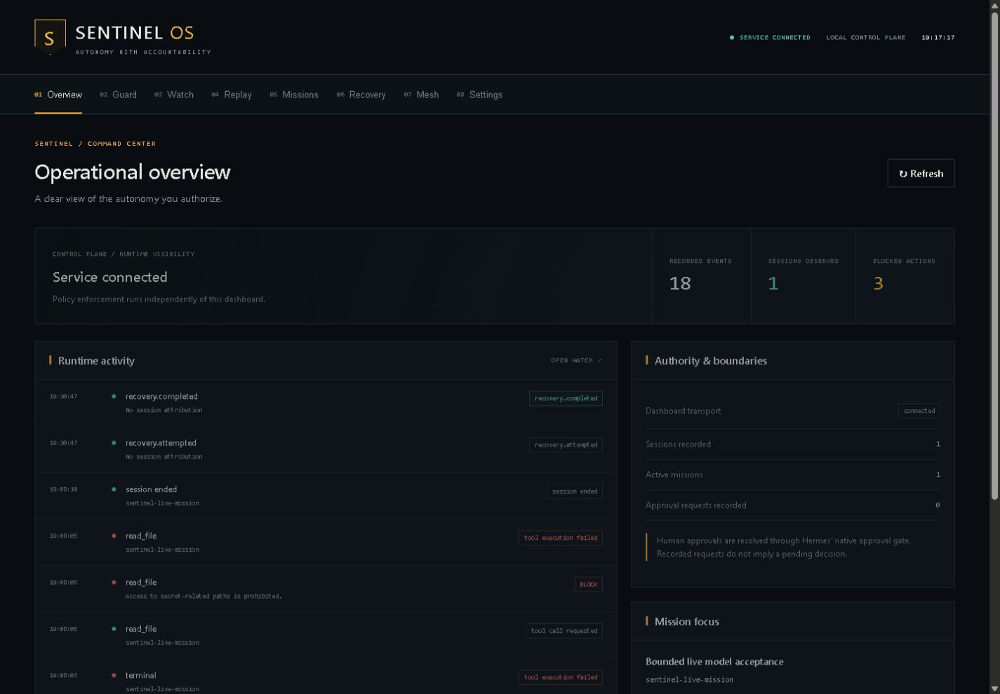

# SENTINEL OS

**The control plane for autonomous AI agents.** Built by folarihn.

SENTINEL is a local Hermes plugin that evaluates tool requests before execution,
records redacted runtime events, and gives operators a Control Room for investigating
sessions and assigning bounded missions. Supported local file changes can be
checkpointed and restored with conflict checks.

Version 0.1.1 is a tested release candidate with explicit acceptance gaps. See
[build evidence](docs/BUILD_STATUS.md) for verified features and remaining work.



## Run locally

Python 3.11 or newer is required. There are no mandatory runtime dependencies.

```powershell
python -m pip install .
python -m sentinel.server --workspace "C:\path\to\your\disposable-project"
```

Open the printed localhost address. Enter the generated session token in Settings.
The service binds only to `127.0.0.1`; authenticated APIs reject foreign browser
origins and DNS rebinding hosts. Keep this token local. Closing the dashboard does
not disable plugin enforcement.

By default both processes use `$HERMES_HOME/sentinel` (or `~/.hermes/sentinel`).
Set `SENTINEL_HOME` for an isolated data directory. The dashboard's `--data` must
point to that same directory to show the plugin's journal. Dashboard connection
does **not** prove that the Hermes plugin is enabled or healthy.

The supplied personal Hermes Python environment may use `uv` without `pip`.
To keep that installation unchanged, use `uv venv .venv` followed by
`uv pip install --python .venv/Scripts/python.exe .`, then run the service with
`.venv/Scripts/python.exe -m sentinel.server` on Windows.

## Install as a Hermes plugin

Verified host: Hermes **0.20.0**, Python 3.11.14. Sentinel uses only official
plugin registration and lifecycle hooks. No Hermes core changes are required.

In a disposable profile, copy this repository into
`$HERMES_HOME/plugins/sentinel/`, including root `plugin.yaml`, root `__init__.py`,
and the `sentinel/` package. Add `sentinel` to `plugins.enabled` in that profile's
`config.yaml`, preserving other enabled entries. Restart that Hermes process.
Do not enable project plugins globally just to test Sentinel.

```yaml
plugins:
  enabled:
    - sentinel
```

The test harness performs fresh discovery in a temporary profile without changing
your personal configuration. The official installer was also verified in a
temporary profile using `hermes plugins install https://github.com/folarihn/Sentinel.git --enable`.
Reproduce it with `python scripts/verify_install.py` in an authenticated Git environment.
Catalog validation remains a separate release gate. This repository remains private; no
catalog install-by-name command is claimed yet.

## Six connected systems

- **Guard:** deterministic mandatory rules plus narrower mission authority;
  unknown shell/code execution escalates to native approval.
- **Watch:** SQLite event journal with safe journal-mode selection, correlation IDs, pagination, retention,
  sanitized export, and dashboard polling.
- **Replay:** read-only timeline, session filtering, search, and JSON reports.
- **Mission Control:** persisted mission lifecycle and seven policy templates;
  paused and expired associated missions block subsequent requests.
- **Recovery:** explicit file checkpoints, post-write sealing, integrity checks,
  conflict detection and atomic restoration. Automatic capture is narrowly scoped.
- **Mesh:** shared journal and derived multi-session registry; available identities
  are preserved without inventing agent IDs or liveness.

## Test

```powershell
python -m unittest discover -v
node --check sentinel/web/app.js
python -m compileall -q sentinel
```

The optional installed-Hermes test uses the actual plugin loader and native
approval gate with fixture human decisions. It runs no LLM and executes no
terminal tool body. A separate `test_host_execution.py` executes actual harmless
Hermes terminal/file tools and restores disposable files. Both skip when Hermes
is unavailable. Windows symlink tests
may skip without Developer Mode or the required privilege. CI is configured;
remote success must be established from an actual workflow run.

The approved live OpenRouter test independently verified model-driven terminal
execution, file writing, automatic checkpointing and restoration in two API calls.
It used process-memory credentials and an isolated profile. This does not establish
all ten live scenarios or live human approval interaction. See
[sanitized live evidence](docs/LIVE_ACCEPTANCE.json) and
[actual host acceptance](docs/HOST_ACCEPTANCE.md). Re-running live tests requires
explicit provider authorization; ordinary CI performs no model requests.

## Security boundary

This is a trusted in-process hook plugin, **not an OS sandbox**. Mandatory blocks
cannot be relaxed by missions. The host's first valid plugin directive wins;
another earlier plugin can affect enforcement. Disabled/unloaded plugins cannot
protect execution. Hermes owns approval transports and approval modes, including
YOLO and cron behavior. No MODIFY directive or dashboard approval authority is
claimed for this host version.

Directory-scoped missions conservatively reject shell operations that cannot be
confined by inspection; a working directory is not isolation. Symlink resolution
does not eliminate filesystem races. Arbitrary interpreter, network redirect,
custom tool, and shell side effects cannot be universally inspected or undone.
Checkpoint contents are local plaintext backups in the trusted database; event
redaction is best-effort and cannot identify every arbitrary secret.

See [security model](docs/SECURITY.md), [architecture](docs/ARCHITECTURE.md),
[verified host APIs](docs/HERMES_API.md), [mission templates](docs/MISSION_TEMPLATES.md),
and [demo guide](docs/DEMO.md).

Final acceptance additionally verified a real mission-scoped coding repair,
model-generated destructive/secret/out-of-scope attempts being blocked, and
restoration of the actual agent change. The owner also made four genuine native
approval decisions for two commands. A subsequent genuine denial run verified
rejection at Sentinel escalation and the native shell checkpoint, with neither
disposable marker written. See [final model evidence](docs/FINAL_LIVE_ACCEPTANCE.json)
and [actual human evidence](docs/ACTUAL_HUMAN_ACCEPTANCE.json).

Watch retains a bounded browser event window; Replay searches and pages the
persistent journal. Exports explicitly describe the loaded scope. During an
outage, previously loaded Replay evidence remains visible with a stale warning.

## Contribution and licensing

Copyright (c) 2026 folarihn. Sentinel is licensed under the [MIT License](LICENSE).
See [contributing](CONTRIBUTING.md). Public visibility and publication still require owner approval.
