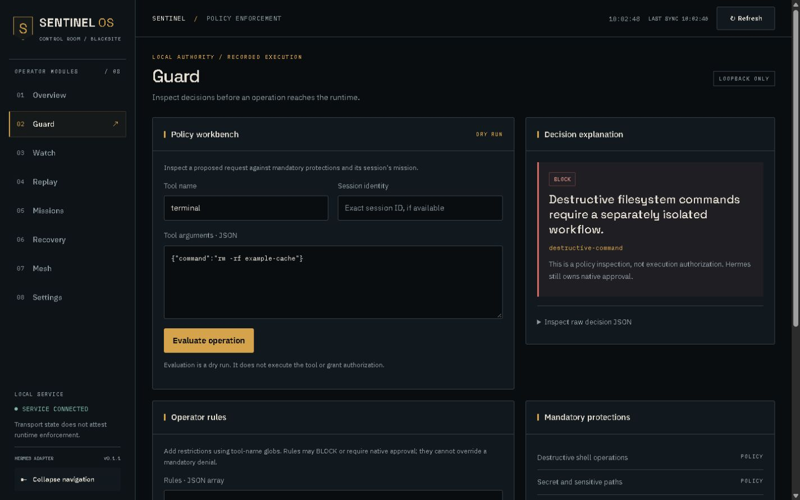

# SENTINEL OS

**Local policy, execution history, and supported-file recovery for Hermes.**

Sentinel evaluates supported tool requests before they run and records redacted
runtime events in a local SQLite journal. Its Control Room helps you inspect
policy decisions, investigate execution history, assign bounded missions, and
restore supported local file changes.

The **BLACKSITE Control Room** uses a persistent module sidebar on desktop, a
keyboard-accessible drawer on mobile, locally served typography, and restrained
status motion. [Explore the eight operator views](docs/CONTROL_ROOM.md).

Sentinel is trusted code running inside Hermes. It is **not an OS sandbox**.



The screenshots are genuine BLACKSITE interface captures. Guard's policy laboratory
inspects a proposed operation; it does not execute it or grant approval.
[View the mobile interface](docs/images/guard-mobile.jpg).

## What Sentinel provides

- **Guard:** mandatory protections, restrictive operator rules, mission scope,
  and escalation to Hermes' native approval pathway.
- **Watch and Replay:** persisted runtime events, session filters, search,
  pagination, and read-only investigation. No tool re-execution from Replay.
- **Mission Control:** server-side mission lifecycle and seven permission
  templates. Paused or expired associated missions block future requests.
- **Recovery:** checkpoints for supported structured file writes, post-write
  sealing, integrity checks, conflict detection, and authorized restoration.
- **Mesh:** recorded session and agent identities when supplied by the host.
  Recorded activity is not a claim that a process is still alive.

## Install

Requires Python **3.11+** and a compatible Hermes installation. The integration
has been exercised with Hermes **0.20.0 on Windows**. Sentinel declares no
mandatory third-party runtime dependencies.

Using Hermes' official CLI in the profile you intend to enable:

```shell
hermes plugins install https://github.com/folarihn/Sentinel.git --enable
hermes plugins list
```

Restart the relevant Hermes process and check that Sentinel is enabled without
load errors. For an immutable revision, disposable-profile testing, or a slow
clone that exceeds the host installer's timeout, follow the
[pinned installation guide](docs/INSTALLATION.md). Catalog install-by-name is not
available until a catalog entry is accepted.

## Open the Control Room

From a reviewed Sentinel checkout, use a separate virtual environment:

```shell
python -m venv .venv
```

Activate it using your shell's standard activation command, then run:

```shell
python -m pip install .
python -m sentinel.server --workspace PATH_TO_YOUR_WORKSPACE
```

Open the printed loopback address and enter the locally generated token in
Settings. The dashboard is a separately started local service; connecting to it
does not prove the Hermes plugin is enabled. Closing it does not disable policy.

The plugin and dashboard must use the same state directory: `SENTINEL_HOME`,
otherwise `$HERMES_HOME/sentinel`, otherwise `~/.hermes/sentinel`. Pass `--data`
explicitly if needed. [Installation and configuration](docs/INSTALLATION.md)
explains profile selection and shared state.

## Security boundaries

- Enforcement depends on an enabled, successfully loaded plugin and supported
  host dispatch. Hermes plugin ordering can affect the first returned directive.
- Native approval modes remain authoritative. YOLO can bypass escalation;
  an explicit Sentinel BLOCK still blocks. Sentinel has no dashboard approval
  authority and does not claim every host mode prompts a human.
- Missions narrow authority but do not isolate processes. Unknown shell behavior
  requires approval or is blocked by mission scope; arbitrary scripts and tools
  cannot be universally inspected.
- Events are redacted on a best-effort basis. Original checkpoint bytes remain
  plaintext local backups. Protect the state directory and dashboard token with
  OS permissions; do not expose the dashboard to the internet.
- Recovery is limited to supported local files. It cannot undo remote APIs,
  emails, deployments, database writes, or arbitrary shell side effects.
  Filesystem races remain a residual risk.

Read the [security model](docs/SECURITY.md) before enabling the plugin.

## Develop and contribute

```shell
python -m unittest discover -v
node --test tests/frontend.test.cjs
node --check sentinel/web/app.js
```

Tests use disposable data. Optional installed-Hermes tests skip when Hermes is
unavailable; ordinary CI makes no model requests. See [testing](docs/TESTING.md)
for optional integration checks, build commands, and fixture disclosures.

- [Architecture](docs/ARCHITECTURE.md)
- [Hermes integration contracts](docs/HERMES_API.md)
- [Operator policies](docs/POLICIES.md)
- [Mission templates](docs/MISSION_TEMPLATES.md)
- [Contributing](CONTRIBUTING.md) and [changelog](CHANGELOG.md)

## License

Copyright (c) 2026 folarihn. Sentinel code is under the [MIT License](LICENSE);
bundled fonts are under OFL-1.1.
See [bundled material and third-party rights](docs/LICENSING.md).
