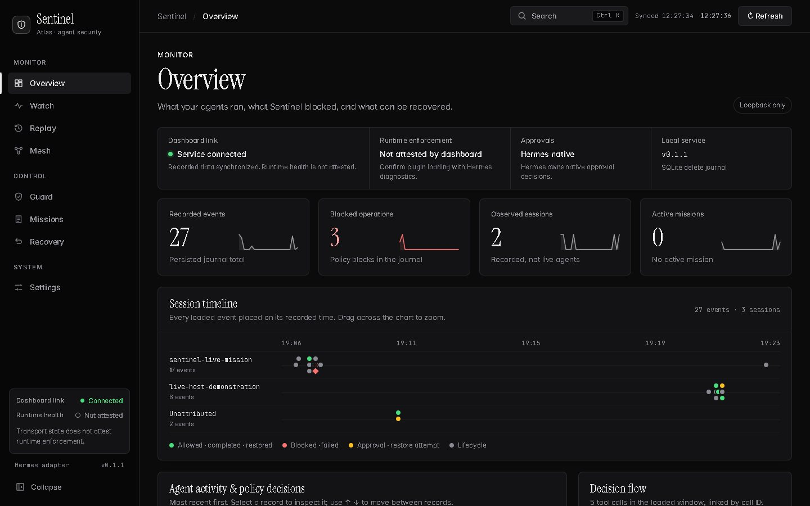
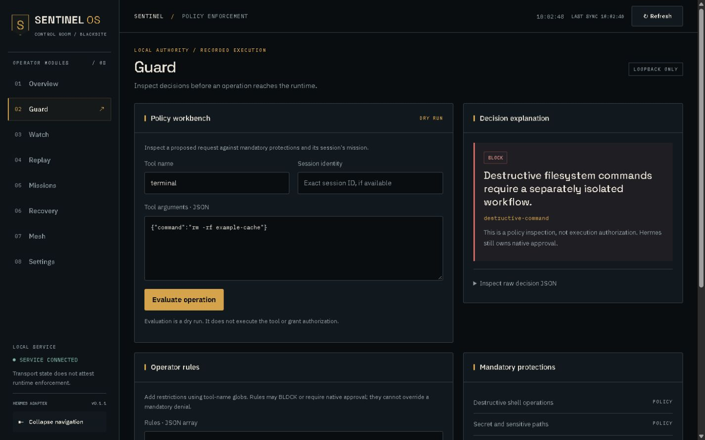

# ATLAS Control Room

The buildless interface uses local HTML, CSS and JavaScript. No runtime font CDN,
charting service, analytics, UI framework or remote dashboard service is required.
Every chart, count and animation is drawn from records in the local journal; the
interface never generates synthetic telemetry.

Guard's pictured result is a policy evaluation of `rm -rf ./build`. The command was
not executed. [Mobile Guard](images/guard-mobile.jpg) uses the same backend semantics.

## Eight operator views

- **Overview** shows connection and runtime indicators, journal totals with
  sparklines, a session timeline, the agent activity list, a decision flow,
  recent interventions and recovery readiness. A connection attests only
  dashboard transport; runtime health is labelled as not attested.
  - The **session timeline** places each loaded event on its recorded time, one
    lane per session. Drag to zoom, double-click to reset, hover for a preview.
  - The **decision flow** links decisions to outcomes only through the
    `tool_call_id` Hermes records. Selecting a path filters the activity list.
  - Selecting a record opens the **inspector**: reason, tool-call chain, position
    in the session and recorded fields. Arrow keys move between records.
- **Guard** is a dry-run policy workbench with example requests, a rule-activity
  panel built from recorded decisions, and the restrictive-rule editor. Saving
  rules changes future requests and never overrides mandatory protections.
- **Watch** polls persisted events and summarises the loaded window by outcome.
  Search filters the loaded window; the export identifies that scope. New-record
  highlights correspond only to newly received journal records.
- **Replay** queries the stored journal by search and session, plots loaded
  history on a timeline, paginates and exports the loaded scope. It never
  re-executes tools. Unavailable history keeps prior records with a stale notice.
- **Missions** shows recorded authority, expiry (absolute and relative), session
  identity, approved tools and lifecycle. Conflicting or expired activation is
  disabled with an explanation.
- **Recovery** shows each checkpoint's recorded lifecycle (captured, sealed,
  restored or failed), timestamps, hashes and supported actions. Restore requires
  confirmation and backend checks. No file contents or invented diff are exposed.
- **Mesh** is an observed session registry with each session's loaded events.
  No parent-child connections or live process state are inferred.
- **Settings** authenticates to the local service, shows diagnostics, lists
  keyboard shortcuts and applies confirmed event retention. A one-time login link
  (`#login=…`) is moved into the tab and cleared from the address bar; tokens are
  never sent in URLs or rendered as page text.

## Navigation, keyboard and motion

The desktop sidebar groups modules under Monitor, Control and System and can
collapse. On smaller screens a drawer provides navigation with focus containment,
Escape dismissal and focus restoration. `Ctrl+K` or `/` opens a command palette
that searches modules, sessions, policy rules and loaded events.

Motion marks navigation, the first drawing of charts, actual metric changes and
newly observed events. `prefers-reduced-motion` disables animations and
transitions. Colour is reserved for meaning: green for allowed or verified, red
for blocked or failed, amber for approval or attention.

Typography uses Instrument Serif, Inter and JetBrains Mono served locally under
OFL 1.1; see [font notices](../THIRD_PARTY_NOTICES.md). The service's content
security policy forbids inline styles, so chart geometry is applied through the
CSSOM rather than by relaxing the policy.

Disconnected views retain the last recorded snapshot and label it as offline or
stale. Unknown totals are unavailable rather than fabricated.

The dashboard is not an OS sandbox or a native approval authority. See the
[security boundary](SECURITY.md), [installation](INSTALLATION.md) and
[testing](TESTING.md) guides before enabling Sentinel.
